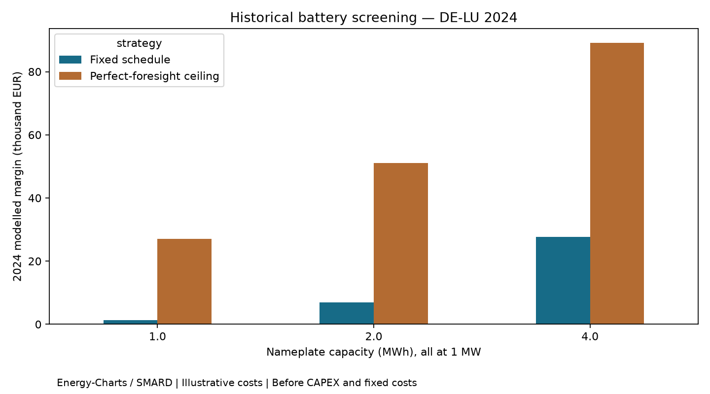

# Battery Market Decision Lab

Decision-support research for battery storage in the German electricity market. **Stage 1: historical day-ahead revenue screening.** This is not yet an investment valuation, forecast-driven strategy or live trading service.

The first question is: *How does modelled annual arbitrage margin change across 1 MW batteries with 1, 2 and 4 MWh nameplate capacity, after losses and assumed variable costs?*

**Verified:** full 2024 run completed for all nine configuration/strategy combinations; nine tests passed. See the report for executed results and assumptions.

## Current functionality

- Token-free DE-LU hourly prices for the full 2024 calendar year, with source license and retrieval hashes.
- Mixed-integer dispatch optimisation with SOC, power, efficiency, cycling and terminal-state constraints.
- Three comparators: idle, fixed midnight charging/evening discharge, and perfect foresight.
- Energy-balance checks, daylight-saving tests, cash-flow reconciliation and an executed annual comparison.

The perfect-foresight case sees all prices before selecting dispatch and is a theoretical ceiling under the stated constraints. A day-ahead bidder would not know clearing prices before bidding. The fixed schedule uses no future prices, but it is an illustrative rule chosen for demonstration, not a held-out validated strategy. Every trade is assumed to clear at the published price. Neither comparison is a trading recommendation.

## Reproduce

Python 3.11+:

```powershell
python -m venv .venv
.\.venv\Scripts\Activate.ps1
python -m pip install -r requirements.txt
python -m pytest -q
python -m battery_lab.run
```

No API key is required. The first run downloads prices; subsequent runs verify and reuse the cached response. Rate-limit errors stop with an HTTP error; wait before retrying. This release deliberately supports 2024 hourly prices only. Later market-time-resolution changes require an extension rather than silent resampling.

[Read the executed report](reports/market-report.md) · [Development roadmap](docs/ROADMAP.md) · [Model specification](docs/MODEL.md)



## Assumptions and limitations

All battery parameters are illustrative and editable in `battery_lab/model.py`: 90% round-trip efficiency; 10–90% SOC; EUR 1/MWh fee on both energy legs; EUR 5/MWh discharged wear allowance; one daily equivalent cycle over usable energy. Initial and final SOC equal the minimum every day. Constant capacity and efficiency; no outage, thermal or calendar-ageing model. These are not equipment quotations or jurisdiction-specific tariffs.

Margin excludes CAPEX, fixed OPEX, financing, taxes, grid-connection costs and imbalance settlement. More capacity and greater annual margin do not establish a better investment. One historical year is not a lifetime revenue forecast. There is no forecast-driven backtest, live dispatch, ancillary-service income or valuation yet. The roadmap separates these stages and acceptance criteria.

Source: [Energy-Charts API](https://api.energy-charts.info/), with DE-LU prices attributed to Bundesnetzagentur | SMARD.de under CC BY 4.0 in the response. Derived results transform the data through simulated operation. Raw data is excluded from Git; retrieval provenance is included with results. This standalone project builds on [European Power Market Fundamentals](https://github.com/SaeedAkbare/Market-Analysis-Load-Price-Trend-Analysis) without altering it.
